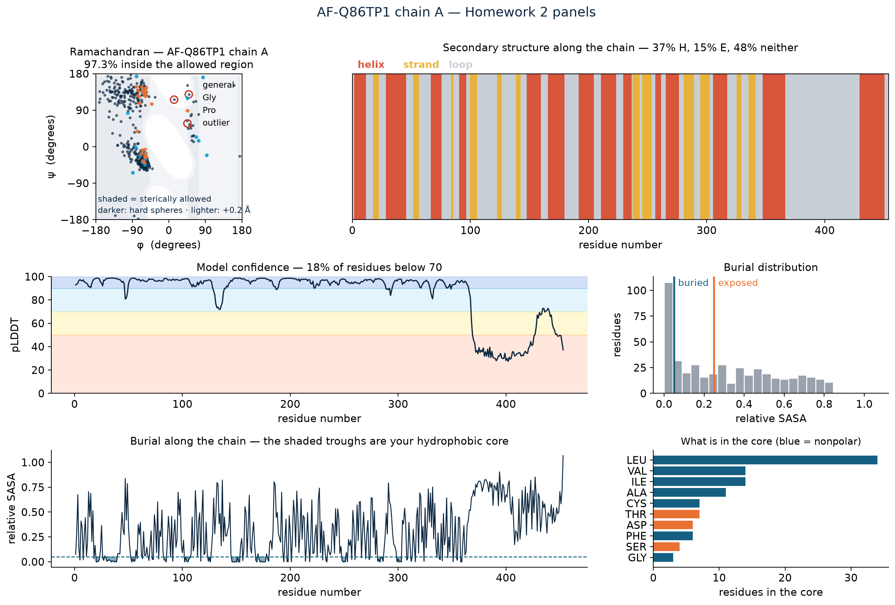

# Homework 2 — AF-Q86TP1, chain A

- file: `AF_Q86TP1.pdb`
- title: Alphafold Monomer V2.0 Prediction For Exopolyphosphatase Prune1 (Q86Tp1)
- method: predicted model (AlphaFold DB)
- models in the file: 1  (more than one means an NMR ensemble)
- chains with >= 20 residues: A
- residues analysed in chain A: 453

## Backbone conformation

- residues with both φ and ψ defined: 451
- inside the strict hard-sphere band from the lecture (0.30 Å tolerance): 97.3%
- non-Gly, non-Pro residues outside the loose band (0.50 Å) — the ones actually worth inspecting: 2
    - GLU374: φ = +13°, ψ = +116°, overlap 0.75 Å
    - ASP388: φ = +49°, ψ = +129°, overlap 0.74 Å
- glycines in a left-handed conformation (φ > 0): 4 of 14 — Gly98, Gly188, Gly245, Gly424
- cis peptide bonds (|ω| < 90°): 2 — PRO322 (ω = 1°), GLN400 (ω = 74°)

## Secondary structure

- α-helix: 37%   β-strand: 15%   neither: 48%
- elements: 14 helices, 12 strands
- longest element: helix 430–450 (21 residues)
- backbone hydrogen bonds found: 300

Secondary structure string (H = helix, E = strand, L = loop):

```
    1  LHHHHHHHHHHLLLLLLEEEEELLLLLLHHHHHHHHHHHHHHHHHLLLLLLEEEEELLLL
   61  LLLLLLHHHHHHHHHLLLLLLLLEELLLLLHHHHHHLLLEEEEEELLLLLLLLLLLLLLL
  121  LLEEEELLLLLLLLLLLLEEEELLLLLHHHHHHHHHHHHLLLLLLHHHHHHHHHHHHHHL
  181  LLLLLLLLLLLHHHHHHHHHHHHHLLLLLLHHHHHHHHHHHHHLLLLLLHHHHHHHLEEE
  241  EEELLEEEEEEEELLLHHHHHLLLLHHHHHHHHHHHLLLLEEEEEEEEELLLLLEEEEEE
  301  EELLLHHHHHHHHHHHHLLLLLLLLEEEELLLLLLEEEEEELLLLLLHHHHHHHHHHHHH
  361  HHHHHHLLLLLLLLLLLLLLLLLLLLLLLLLLLLLLLLLLLLLLLLLLLLLLLLLLLLLL
  421  LLLLLLLLLHHHHHHHHHHHHHHHHHHHHHLLL
```

## Burial

- buried (relative SASA < 0.05): 115 residues (25%)
- exposed (relative SASA > 0.25): 238 residues (53%)
- hydrophobic fraction: 80% of buried residues, 38% of exposed ones
- most buried residues: LEU218 (0.00), LEU201 (0.00), ALA169 (0.00), LEU234 (0.00), SER34 (0.00)
- most exposed residues: LYS453 (1.07), LEU394 (0.90), LYS427 (0.85), GLU47 (0.84), GLU381 (0.83)

## Interface

- only one chain in this file, so there is no interface to measure. If your protein is known to act as a dimer or a larger complex, say so, and check whether the PDB entry lists a biological assembly larger than what the file contains (REMARK 350).

## Figures



## Questions to answer in your own words

- Which secondary-structure class does your protein belong to (all-α, all-β, α/β, α+β), and
  which numbers above support that?
- Pick one glycine and one proline in your structure. What would happen if each were
  substituted, and why — use their φ/ψ values, not general statements.
- Name one buried and one exposed residue from the lists above. For each, say what you would
  expect a hydrophobic-to-polar substitution to do, and why they differ.
- If your file has more than one chain: are the interface residues of the isolated monomer
  buried or exposed? If it has one chain: is that the biological unit?
- Look at the B-factor (or pLDDT) profile. Where is the structure least reliable, and would you
  trust a structural argument about a variant in that region?
- Any Ramachandran outliers? For each, decide whether it is a real strained conformation or a
  modelling error, and say how you decided.

